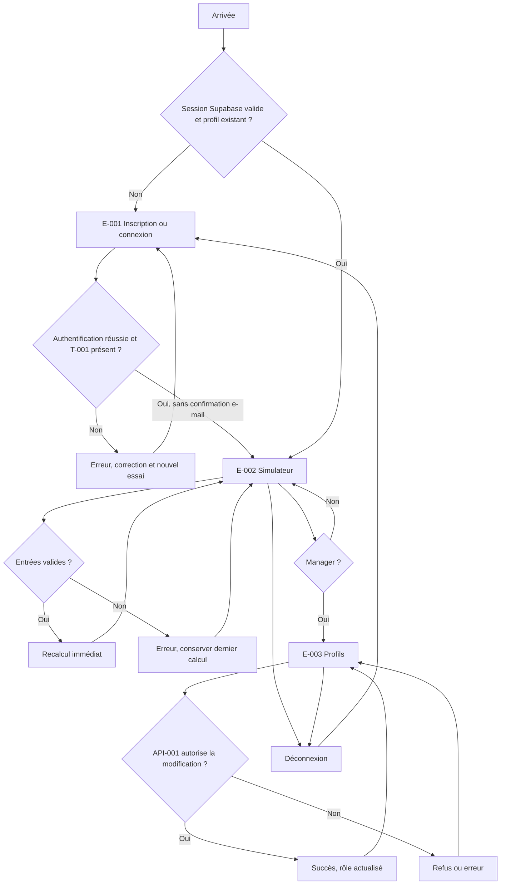

# APP FLOW — Clair

> **PHASE 06 — PROPOSITION DE PASSATION, NON ENCORE VALIDÉE** · 13/11/2026.
> **Source de vérité produit :** Notion « Maquette prêt bancaire » (copie du template), pages 01 à 05. En cas de divergence, remonter la question avant de changer le périmètre.
> **Verdict phase 05 : GO AVEC RÉSERVES**. Documentation seulement ; aucune implémentation réelle, aucun test technique Supabase effectué.

## Écrans et routes représentées dans le prototype
| Référence | Route du prototype (fragment) | Accès cible après raccordement Supabase | Fonction |
|---|---|---|---|
| E-001 | `#/inscription`, `#/connexion` | Public | S'inscrire / se connecter avec Supabase Auth ; écran de confirmation e-mail **hors flux cible** |
| E-002 | `#/simulateur` | Exécutant ou Manager authentifié, profil présent | Saisie, recalcul local, trois résultats, déconnexion |
| E-003 | `#/profils` | Manager authentifié | Liste, dialogues et changement de rôle via API-001 |

Les fragments ci-dessus décrivent l'**existant du prototype HTML** ; l'architecture définit la sécurité, **pas une obligation de conserver le routeur fragmenté**. Ne pas ajouter de nouveau schéma de route sans besoin validé.

## Transitions et erreurs
| Départ | Événement | Condition | Arrivée / état |
|---|---|---|---|
| Visiteur | Inscription | Champs valides, compte créé, profil Exécutant présent | E-002 ; aucune confirmation e-mail (AC-008, AC-009) |
| E-001 | Connexion | Identifiants valides, session et profil présents | E-002 (AC-010) |
| E-001 | Erreur de connexion | Invalidité, compte manquant ou réseau | Rester E-001, afficher retour utile, sans divulgation excessive |
| E-002 | Saisie valide | Bornes, pas et durée correcte | E-002, résultats recalculés (AC-005) |
| E-002 | Saisie invalide | Vide / non-numérique / hors limites / pas incorrect | E-002, erreur + dernier calcul valide (AC-006) |
| E-002 | Ouvrir Profils | Rôle courant Manager | E-003 ; Exécutant refusé (AC-013/014) |
| E-003 | Modifier rôle | Cible autre que soi ; autorisation via API-001 | Dialogue cible, succès et liste actualisée (AC-015) |
| E-003 | Erreur/changement non autorisé | Exécutant, rôle périmé, soi-même, panne | Refus et données inchangées |
| E-002/E-003 | Session expirée/déconnexion | Session absente / révoquée | E-001 ; ne pas maintenir de privilèges via l'état local |

## Mermaid — flux cible simplifié

**Références :** schéma SVG V2 présent dans [Notion 03](https://app.notion.com/p/416282ff070c8092acd6e422c91cc57b), Figma [Clair](https://www.figma.com/design/wtOEvu4ByhQBenwgCVU5Kv/Clair-%E2%80%94-Phase-03-UX-UI-%C2%B7-Parcours-et-%C3%A9crans?node-id=0-1), prototype [demo](https://drive.google.com/drive/folders/1QX_fBNtHYzN5zW_Eop4MuDOBzHs0sCBq). L'ancien diagramme SVG V1 et les écrans de confirmation fictive sont **historiques/archivés**, pas une prescription courante. Les états contextuels chargement, vide et erreur ne sont pas tous représentés par des écrans complets Figma ; les prendre dans le prototype React corrigé.

**Traçabilité :** [D02](https://app.notion.com/p/416282ff070c80cca178f8341bf0513b) · [D03](https://app.notion.com/p/416282ff070c8092acd6e422c91cc57b) · [D05](https://app.notion.com/p/416282ff070c80b7b44fd5819fa94049).
