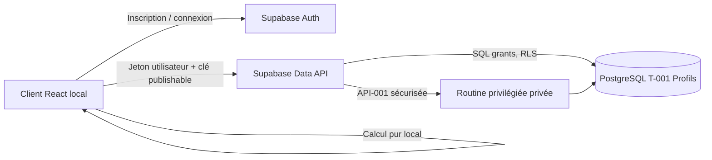

# Architecture technique — Clair

> **PHASE 06 — PROPOSITION DE PASSATION, NON ENCORE VALIDÉE** · 13/11/2026.
> **Source de vérité produit :** Notion « Maquette prêt bancaire » (copie du template), pages 01 à 05. En cas de divergence, remonter la question avant de changer le périmètre.
> **Verdict phase 05 : GO AVEC RÉSERVES**. Documentation seulement ; aucune implémentation réelle, aucun test technique Supabase effectué.

## Mode retenu
**VALIDÉ (phase 04)** : frontend React/htm local (outillage local léger Vite **PROPOSÉ**, ne pas forcer), Supabase Auth, PostgreSQL + RLS, API de données managée et fonctions privilégiées contrôlées. **Pas de serveur applicatif Node supplémentaire**. Réutiliser le prototype corrigé sans lui attribuer une sécurité réelle. Aucune base ou projet Supabase n'a été créé à cette étape.

## Frontières de confiance et flux

- Navigateur : validation UX, calcul intérêts simples, présentation ; ses rôles/sessionStorage ne sont **pas** une preuve d'autorisation.
- Auth : identité et session e-mail/mot de passe ; **Confirm Email désactivé uniquement pour la démo**, sans SMTP. Adresse non vérifiée.
- PostgreSQL : source du rôle `executant` ou `manager` dans T-001 ; droits SQL et RLS ; API-001 autorise des changements contrôlés en transaction.
- Clé publishable côté frontend ; jamais `service_role` / secret. Les autres lectures privilégiées de `auth.users` passent par un chemin contrôlé, jamais par exposition générale d'Auth.

## Domaine, environnement et coûts
- Une seule application, pas de multi-tenant, pas d'hébergement public demandé. Frontend sur ordinateur local, Supabase distant, Internet requis.
- Projet Free **PROPOSÉ**, sous quotas et disponibilité ; 0 € et moins de 7 jours = objectifs non garantis. Région UE **PROPOSÉE**, choix opérationnel à confirmer lors de la configuration.
- Développement/test avec comptes fictifs ; aucun utilisateur externe avec adresse personnelle avant résolution du RGPD. Éviter dépendances payantes.
- Pas de Docker, SSR, middleware commercial, webhooks, n8n, Storage, paiement, IA, Realtime ni API bancaire nécessaires.

## Données et opérations
- Entité T-001 (UUID Auth et rôle) + e-mail dans Supabase Auth ; aucune table de simulations, aucun historique financier.
- API-001 (identifiant stable) : modifier le rôle d'un **autre** compte, après vérification du Manager courant, session active et rôle en base, transaction/verrouillage. Pas de mise à jour client directe T-001.
- Déconnexion : nettoyer état client + révocation effective côté fournisseur lorsque possible ; tester les jetons encore valides.

## Environnements / questions ouvertes
- À DÉFINIR : configuration projet Free, noms physiques fonctions privées, procédure d'accès local, variables d'environnement **noms uniquement**, protection des données et backups. Ne pas imposer une architecture d'hébergement non validée.
- Plan d'implémentation = propriété exclusive de Claude Code en phase 07 ; **ne pas écrire** `IMPLEMENTATION_PLAN.md` ni `PLAN_IMPLEMENTATION.md` en phase 06.
- Prendre la phase 05 comme verdict **GO AVEC RÉSERVES** : elle n'autorise ni déploiement ni création de services sans instruction correspondante.

**Traçabilité :** [D02](https://app.notion.com/p/416282ff070c80cca178f8341bf0513b) · [D04](https://app.notion.com/p/416282ff070c809395d5c6339be59c2a) · [D05](https://app.notion.com/p/416282ff070c80b7b44fd5819fa94049).
